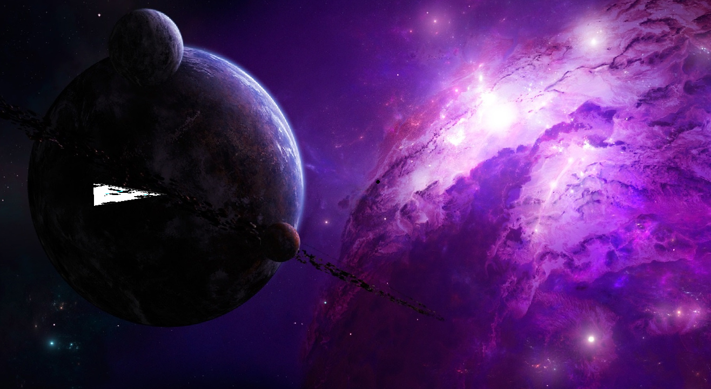
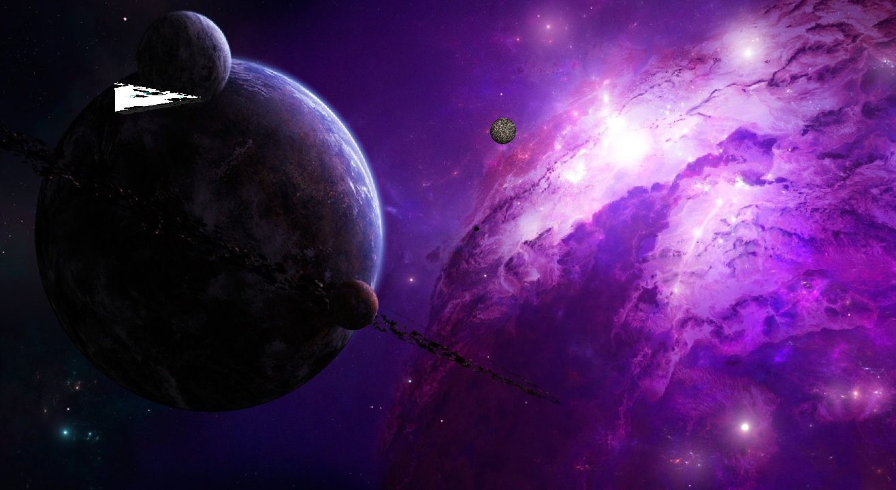

# Kg_Curs

Игра на C++ и OpenGL: управляйте планером и уклоняйтесь от шаров, летящих справа налево. Цель — продержаться как можно дольше. Со временем скорость шаров и частота их появления увеличиваются.

## Запуск

Все пути указаны относительно корня проекта. Выполняйте команды из этой папки.

### Windows

Для запуска готовой сборки нужны **64-разрядная Windows**, Python 3 и файл `build/Kg_Curs.exe`. Откройте PowerShell в корне проекта и выполните:

```powershell
python scripts/prepare_models.py
Push-Location OpenGLrememberProj
..\build\Kg_Curs.exe
Pop-Location
```

Рабочая папка игры должна быть `OpenGLrememberProj`, чтобы загружались модели, текстуры и шейдеры. Команды выше задают её автоматически.

Если `build/Kg_Curs.exe` нет, откройте **Developer PowerShell for Visual Studio** в корне проекта и выполните сборку:

```powershell
msbuild OpenGLrememberProj/OpenGLrememberProj.vcxproj /p:Configuration=Release /p:Platform=Win32 /p:OutDir=..\build\ /p:TargetName=Kg_Curs
```

Команда создаёт `build/Kg_Curs.exe`. После успешной сборки выполните команды запуска выше. Файл `.exe` не хранится в Git, поэтому при первом клонировании требуется сборка.

### Ubuntu

Если окружение уже подготовлено:

```bash
./run.sh
```

Для первой настройки на **Ubuntu 24.04 x86_64** нужны Python 3, `apt-get`, `dpkg-deb`, подключение к интернету и графический рабочий стол с поддержкой OpenGL. Предусмотрите около 3 ГБ свободного места.

```bash
./setup-local.sh
./build.sh
./run.sh
```

`setup-local.sh` скачивает и распаковывает MinGW и Wine в `.tools/` без системной установки и `sudo`. `build.sh` собирает `build/Kg_Curs.exe`, а `run.sh` подготавливает модели и запускает игру через Wine с окружением в `.wine/`. Первый запуск может занять некоторое время.

## Как играть

Активируйте окно игры и переключитесь на английскую раскладку.

| Управление | Действие |
| --- | --- |
| **W** | Движение вверх |
| **S** | Движение вниз |
| **Колесо мыши** | Приближение и отдаление камеры |
| **Закрытие окна** | Выход из игры |

Обходите шары по вертикали. При столкновении игра завершается и окно закрывается. Чтобы начать заново, повторите команду запуска для своей системы.

## Скриншоты

Начало игры:



Игровой процесс — движение вверх и приближающийся шар:


